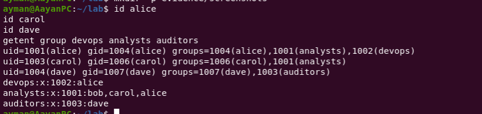
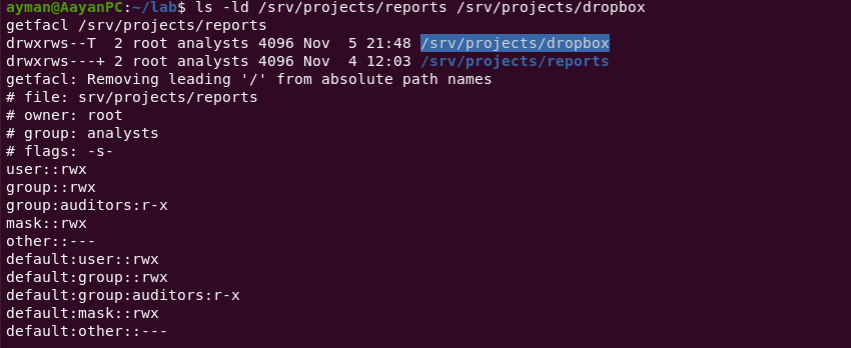
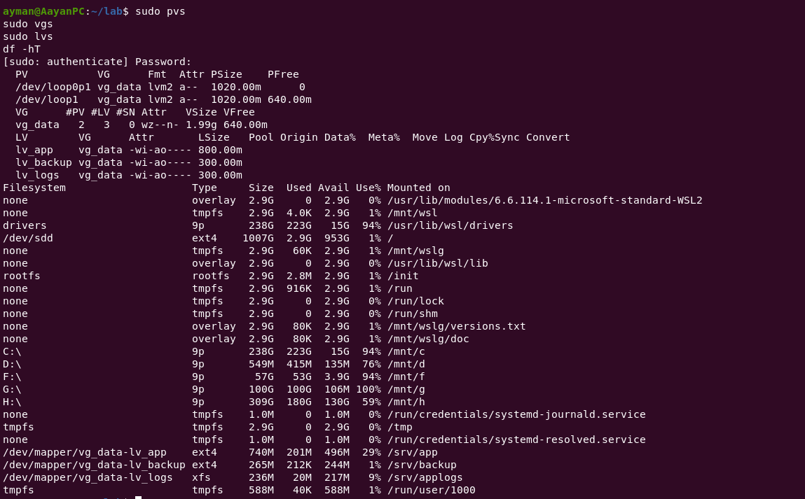
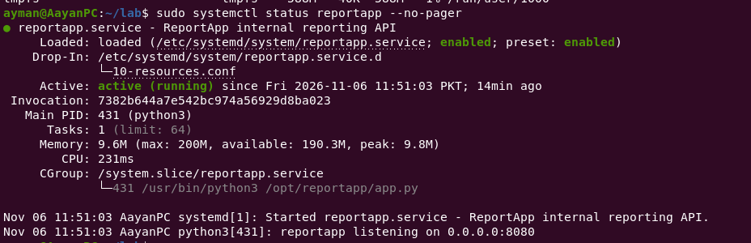
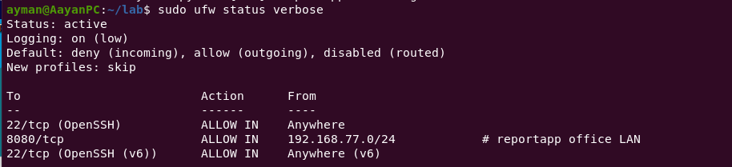
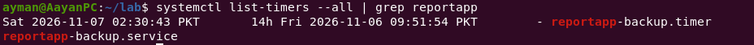
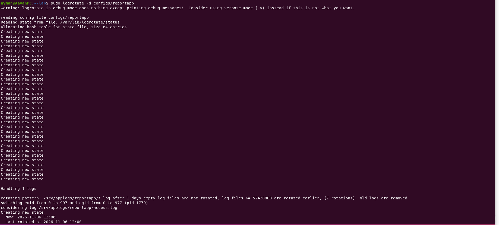
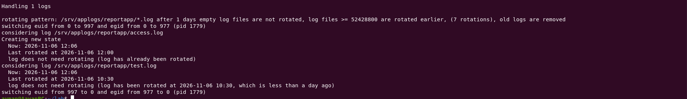

# Linux Deep Dive: Ubuntu Server Administration

A hands-on Linux system administration project demonstrating practical infrastructure management, access control, storage management, service hardening, security configuration, automation, monitoring, and troubleshooting using Ubuntu Server 22.04.

## Project Overview

This project simulates the administration of a Linux-based application environment called **ReportApp**.

The lab focuses on implementing and documenting real-world Linux administration tasks, including managing users and groups, securing shared directories, configuring LVM storage, deploying systemd services, restricting network access, automating backups, and managing application logs.

The objective is to demonstrate practical Linux administration skills through implementation, testing, troubleshooting, and technical documentation.

## Infrastructure Architecture

| Component | Implementation |
|---|---|
| Operating System | Ubuntu Server 22.04 |
| Application | ReportApp |
| Application Port | TCP 8080 |
| Application User | `reportapp` |
| Development User | `alice` |
| Other Users | `bob`, `carol`, `dave` |
| Storage | LVM with two loop disks |
| Volume Group | `vg_data` |
| Filesystems | ext4 and XFS |
| Service Management | systemd |
| Firewall | UFW |
| Remote Administration | SSH |
| Backup Automation | systemd timer and rsync |
| Scheduled Reporting | Cron |
| Log Management | logrotate |
| Scripting | Bash and Python |
| Version Control | Git and GitHub |

## 1. Linux User and Group Administration

Created and managed dedicated Linux accounts and groups for different operational responsibilities.

### Users

| User | Group / Role |
|---|---|
| `alice` | devops |
| `bob` | General user |
| `carol` | analysts |
| `dave` | auditors |
| `reportapp` | Dedicated system account |

### Skills demonstrated

- Linux user and group management
- Account administration
- Group membership configuration
- Ownership and permission management
- Dedicated service account administration

## 2. Shared Directory Permissions and ACLs

Implemented shared project directories with different access-control requirements.

| Directory | Configuration |
|---|---|
| `/srv/projects/reports` | setgid and ACL permissions |
| `/srv/projects/dropbox` | setgid and sticky bit |

### Skills demonstrated

- Linux file permissions
- Ownership and group management
- Access Control Lists (ACLs)
- setgid directory permissions
- Sticky bit configuration
- Shared directory security

## 3. Storage Management Using LVM

Configured logical storage using two loop-backed disks.

### Volume group

`vg_data`

### Logical volumes

| Logical Volume | Filesystem | Mount Point |
|---|---|---|
| `lv_app` | ext4 | `/srv/app` |
| `lv_logs` | XFS | `/srv/applogs` |
| `lv_backup` | ext4 | `/srv/backup` |

### Skills demonstrated

- Disk and partition inspection
- Loop device management
- Physical volume initialization
- Volume group administration
- Logical volume creation
- ext4 and XFS filesystem management
- Filesystem mounting and verification

## 4. ReportApp Systemd Service

Configured a dedicated `reportapp.service` to run the application on TCP port 8080.

### Service management

- Dedicated application service account
- systemd service management
- Service troubleshooting
- Resource limits
- Security sandboxing

### Skills demonstrated

- systemd unit configuration
- Service lifecycle management
- Application service troubleshooting
- Linux service hardening

## 5. Linux Security and Network Protection

Implemented security controls to restrict administrative access and application network exposure.

### SSH security

- SSH hardening using a configuration drop-in
- Review of remote administration settings

### UFW firewall

- Default incoming traffic policy: deny
- LAN-restricted access to TCP port 8080

### Skills demonstrated

- SSH configuration
- Linux firewall administration
- Network access restrictions
- Least-privilege principles
- Service exposure management

## 6. Backup Automation

Implemented automated ReportApp backup scheduling using systemd.

### Configuration files

- `configs/reportapp-backup.service`
- `configs/reportapp-backup.timer`

### Backup configuration

- Nightly scheduled execution at 02:30
- Persistent timer configuration
- Randomized execution delay
- Dedicated backup storage at `/srv/backup`
- Restricted service write access

### Skills demonstrated

- systemd oneshot services
- systemd timers
- Automated backup management
- Storage protection
- Backup verification

## 7. Cron-Based Traffic Reporting

Configured automated traffic report generation.

### Configuration

`configs/reportapp-report`

The scheduled task executes every 15 minutes under the dedicated `reportapp` account.

Report output is directed to:

`/srv/applogs/reportapp/traffic-report.txt`

### Skills demonstrated

- Cron job configuration
- Scheduled script execution
- Service-account execution
- Automated report generation
- Output and error logging

## 8. Log Management and Rotation

Configured logrotate for ReportApp application logs.

### Configuration file

`configs/reportapp`

### Implemented settings

- Daily log rotation
- Seven retained rotations
- 50 MB size threshold
- Compressed rotated logs
- Missing-file tolerance
- Empty-file handling
- Application-specific ownership and permissions

### Skills demonstrated

- Linux log management
- Log rotation
- Log retention
- Disk-space management
- Application log troubleshooting

## 9. Bash and Python Automation

Developed supporting scripts to automate administrative activities.

### Scripts

| Script | Purpose |
|---|---|
| `scripts/reportapp-backup` | ReportApp backup automation |
| `scripts/reportapp-traffic-report` | Traffic report generation |
| `scripts/gen_access_log.py` | Access log generation |

### Skills demonstrated

- Bash scripting
- Python scripting
- Log generation
- Automation
- Administrative task scripting

## 10. Troubleshooting and Technical Evidence

The `evidence/` directory contains documentation of practical lab exercises and verification activities.

| Evidence Document | Subject |
|---|---|
| `user-group-administration.md` | Linux users and groups |
| `acl-management.md` | ACL configuration |
| `reportapp-service-troubleshooting.md` | systemd troubleshooting |
| `reportapp-backup-verification.md` | Backup verification |
| `system-log-analysis.md` | System log investigation |
| `system-resource-monitoring.md` | Resource monitoring |
| `logrotate-test.md` | Log rotation testing |

## 11. Repository Structure

```text
linux-deep-dive-ubuntu-admin/
│
├── README.md
├── .gitignore
│
├── configs/
│   ├── reportapp
│   ├── reportapp-backup.service
│   ├── reportapp-backup.timer
│   └── reportapp-report
│
├── scripts/
│   ├── gen_access_log.py
│   ├── reportapp-backup
│   └── reportapp-traffic-report
│
├── evidence/
│   ├── acl-management.md
│   ├── logrotate-test.md
│   ├── reportapp-backup-verification.md
│   ├── reportapp-service-troubleshooting.md
│   ├── system-log-analysis.md
│   ├── system-resource-monitoring.md
│   ├── user-group-administration.md
│   └── screenshots/
│
├── broken.sudoers
└── devops.sudoers
```

The two sudoers files are separate lab exercise artifacts and are intentionally empty. They are not active sudoers configurations.

## 12. Verification Commands

The following commands can be used to inspect and verify the lab environment.

### Users and groups

```bash
getent passwd alice bob carol dave reportapp
getent group devops analysts auditors
id alice
id carol
id dave
```

### Permissions and ACLs

```bash
ls -ld /srv/projects/reports
ls -ld /srv/projects/dropbox

getfacl /srv/projects/reports
getfacl /srv/projects/dropbox
```

### LVM and storage

```bash
sudo pvs
sudo vgs
sudo lvs
lsblk -f
df -hT
```

### ReportApp service

```bash
sudo systemctl status reportapp
sudo systemctl cat reportapp
sudo journalctl -u reportapp --no-pager -n 50
```

### Firewall

```bash
sudo ufw status verbose
```

### Backup timer

```bash
systemctl list-timers --all
sudo systemctl status reportapp-backup.timer
```

### Cron

```bash
cat configs/reportapp-report
sudo journalctl -u cron --no-pager -n 30
```

### Logrotate

```bash
sudo logrotate -d configs/reportapp
```

### Resource monitoring

```bash
free -h
uptime
df -h
top
```

These are verification commands; actual results depend on the state of the Ubuntu lab environment.

## 13. Tools and Technologies

- Ubuntu Server 22.04
- Linux command line
- Bash
- Python 3
- systemd
- LVM
- ext4 and XFS
- ACL
- SSH
- UFW
- Cron
- logrotate
- rsync
- Git
- GitHub

## 14. Learning Outcomes

Through this project, I developed practical experience in:

- Administering Linux users, groups, and permissions
- Managing shared directories and access controls
- Configuring LVM-based storage
- Deploying and troubleshooting systemd services
- Applying Linux security hardening
- Managing network access and firewall policies
- Automating backups and scheduled reporting
- Managing application logs and resource utilization
- Writing Bash and Python automation scripts
- Documenting technical work and maintaining version control

## Project Status

Core lab implementation completed. Final documentation, screenshot evidence, and repository review are being finalized.

---

**Author:** Ayman Arshad

**GitHub:** https://github.com/aymanarshad

**Repository:** https://github.com/aymanarshad/linux-deep-dive-ubuntu-admin


## Project Screenshots

### 1. User and Group Administration


### 2. ACL Permissions


### 3. LVM Storage


### 4. ReportApp Service


### 5. Firewall Security


### 6. Backup Automation


### 7. Log Rotation


### 8. Additional Log Rotation Evidence

